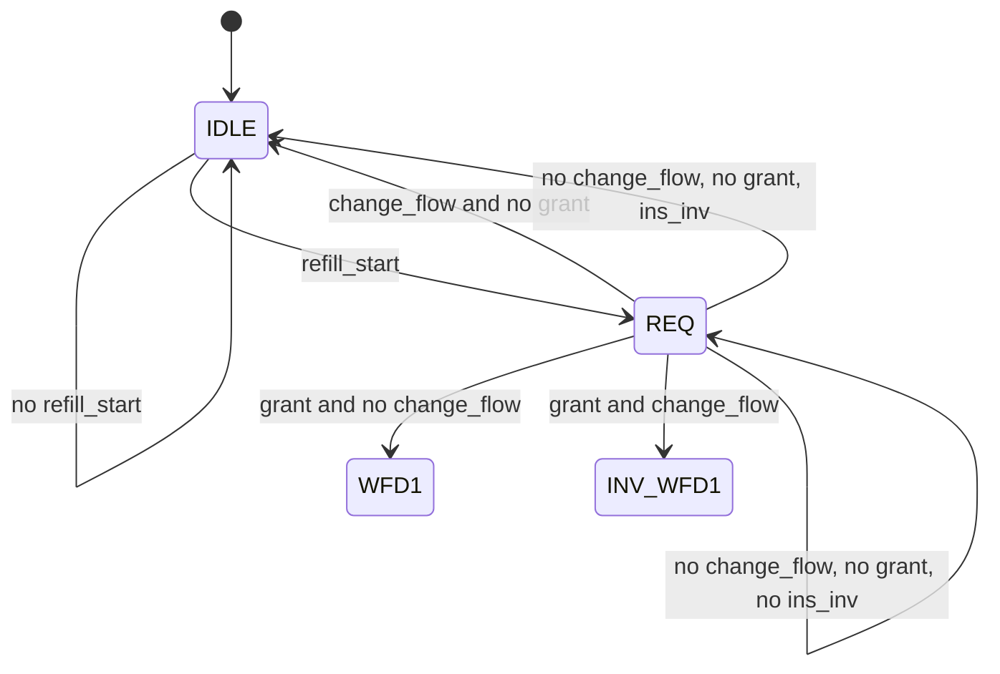
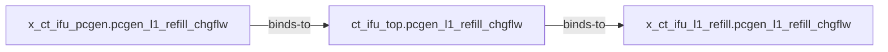

# RTL 分析 Workspace 手册

开发机的唯一 runtime Workspace 是 main checkout 的 `<repo>/src/workspace/`，容器中仍为 `/workspace/`；linked Git worktree 只用于 tracked 产品改动，不另建 runtime `src/workspace/`。某 RTL Project 的实际分析记录在 `projects/<name>/analysis/tasks/`。Workspace 整体不进 Git，也不当缓存清理。

新的默认 Source+Runtime 路线使用 `rtl-query`：Agent 冻结 build identity 后运行一个 task-local PySlang worker，compile/elaborate 一次，通过 `scope / inspect / bindings / uses` 获得带源码位置与 hash 的确定性事实，再阅读最小完整 Source 做语义综合。它不需要或写入 SQLite，task 结束释放全部状态。

需要从既有 Build1 candidate 分块形成语义草稿时，使用发行的 `rtl-build2-draft`；它从公共 Build1 receipt 和 `context` Fact 交接，在 `analysis/tasks/<task>/` 按证据、局部草稿、块自检保存产物及 `skill.state`。新会话核验身份和原件后接续，草稿保持 `DRAFT_UNREVIEWED`，不进入正式知识库。

```sh
rtl --project projects/<name> query --build projects/<name>/runtime-query-build.json
```

父 Skill 会先冻结 Scenario/Start/Stop/Completeness，避免递归 dump；结果为 ambiguous/partial/unsupported 时必须 source fallback，不能猜。Module 功能、复杂 guard/priority/next-state、FSM/temporal/functional flow 仍由 LLM 基于局部完整源码回答。

以下内容是 legacy Project Model MVP 的演示与查询手册；只有用户明确选择预构建路线且 current model 已存在时使用。

## Legacy Project Model MVP

这个 MVP 用一份 SQLite Project Model 承载选定 RTL 代码范围中的结构、连接、行为依赖、时序/FSM、Clock/Reset、工程语义和证据。演示重点不是数据库本身，而是：读代码时遇到疑问，可以直接提问，答案能展示关系、状态和源码证据，也会如实说明尚未覆盖的部分。

legacy Project Model 对 Agent 暴露两个入口：

- `rtl-project-model-mvp-build`：为明确的最小代码范围生成或恢复模型；
- `rtl-project-model-query`：从模型中快速搜索并展示答案。

## 当前开发基准范围

当前 OpenC910 开发基准显式选择 18 个 IFU 文件：

| 文件组 | MVP 中的作用 |
|---|---|
| `ct_ifu_top.v`、`ct_ifu_pcgen.v`、`ct_ifu_addrgen.v` | 顶层装配、PC/change-flow 仲裁与目标修正 |
| BHT、BTB、L0 BTB、indirect BTB、RAS、SFP 及 array/entry 文件 | 方向/目标/返回/推测失败预测及其存储和状态 |
| `ct_ifu_l1_refill.v`、`ct_ifu_precode.v` | refill FSM、请求/返回、I-cache 写入与预解码 |

精确文件清单由当前 Project 的 v2 spec 冻结，不能由 Skill 扫描猜测。当前模型包含 9,489 个实体、18,788 条关系声明、176 个综合寄存 cell、3 个 FSM、15 个状态和 47 个状态转移；所有 assertion 都有 evidence。下面的演示仍以最容易说明跨模块价值的 pcgen → top → l1_refill 子路径为例，不代表只构建了三个文件，也不代表完整 OpenC910。

## 能提供哪些查询，结果怎么展示

用户不必记命令，直接按“我正在看什么、哪里不明白”来问。Agent 会把问题映射到下列只读查询：

| 查询能力 | 可以怎样问 | 查询结果 | 默认展示效果 |
|---|---|---|---|
| 模型概览 | “这次 MVP 分析了什么？” | 模型身份、实体/关系统计、producer、完整性 | 概览表 + 关键数字 |
| 名称搜索 | “名字包含 `refill_cur_state` 的对象有哪些？” | exact/prefix/contains 候选，可按 kind 过滤 | 候选表：类型、完整名称、匹配方式 |
| 模块/实体关系 | “`ct_ifu_l1_refill` 里面有哪些端口和内部对象？” | 实体属性、incoming/outgoing assertions | 对象卡片 + 入/出关系表 |
| 跨模块连接路径 | “这个信号从 pcgen 怎么到 l1_refill？” | 最短结构路径、每一跳关系和 evidence | Mermaid 路径图 + 逐跳证据表 |
| 数据/控制依赖 | “这个信号影响哪些逻辑？它依赖谁？” | `loads`、`drives`、`data-depends-on`、`control-depends-on` | 上游/下游关系表，必要时分组 |
| FSM | “`refill_cur_state` 有哪些状态、怎么转移、谁控制？” | FSM、状态编码、reset state、transitions、control inputs | 状态表 + 转移表 + Mermaid 状态图 |
| 寄存器与 Clock/Reset | “这段时序逻辑用哪个时钟、复位和值？” | register、D/Q、clock/reset、极性、复位值 | Clock/Reset 表 |
| 6+1 覆盖 | “哪些结论已经验证，哪些还只是 partial？” | 每个 scope/dimension 的总体状态及 required capability 细项、producer、reason | 总体表 + 能力细项表（文本状态不隐藏） |
| 工程语义 | “这条 change-flow 信号在 refill 流程里起什么作用？” | tool/human/LLM 语义、confidence、review 状态 | 结论卡片 + 状态标记 + 证据 |
| 证据追溯 | “这条结论来自哪个文件哪几行？” | assertion 对应的 producer、文件、行范围和 hash | 来源证据表 |

通过 `rtl-project-model-query` 父 Skill 发起时，编排 Agent 会把完整 JSON 写入查询 task 的 `artifacts/`。裸 `rtl model query` 只读 SQLite 并输出 stdout，不会自行创建 task。表格和 Mermaid 只是便于阅读的展示，不是第二份知识正本。

## 从真实代码出发的演示问题

### 问题一：看到 FSM 状态寄存器，不知道整体状态机

正在阅读 `ct_ifu_l1_refill.v:323-432`：

```verilog
always @(posedge l1_refill_clk or negedge cpurst_b)
begin
  if(!cpurst_b)
    refill_cur_state[3:0] <= IDLE;
  else
    refill_cur_state[3:0] <= refill_next_state[3:0];
end
```

可以问：

> `refill_cur_state` 是什么状态机？有多少状态，复位状态是什么，主要由哪些输入控制？用状态表和 Mermaid 展示。

实际查询会先搜索 `refill_cur_state`，再查询 `ct_ifu_l1_refill.refill_cur_state@fsm`。当前模型返回：

| 项目 | 结果 |
|---|---|
| 状态数 | 11 |
| 转移数 | 35 |
| 复位状态 | `IDLE` |
| 复位编码 | `0000` |
| 代表性控制输入 | 共 14 个；其中包括 `pcgen_l1_refill_chgflw`、`ipb_l1_refill_data_vld`、`ipb_l1_refill_trans_err`、`ifctrl_l1_refill_ins_inv`、`l1_refill_ipb_tsize` |



图中条件标签来自上面正在阅读的代码上下文；模型独立确认这些状态、转移、复位状态和控制输入。完整 35 条结构化转移及其 current/next-state assertion 保存在查询 JSON；当前 Yosys/KISS2 evidence 定位 FSM state cell，不冒充每个条件分支的精确行号。静态模型不会把它扩大成“所有转移在运行时都可达”的证明。

### 问题二：看到一个跨模块信号，不知道它从哪来、到哪去

正在阅读：

- `ct_ifu_pcgen.v:1051`：`pcgen_l1_refill_chgflw = pcgen_chgflw`；
- `ct_ifu_top.v:3911,4241`：该信号连接两个实例；
- `ct_ifu_l1_refill.v:443`：`change_flow = pcgen_l1_refill_chgflw`。

可以问：

> `pcgen_l1_refill_chgflw` 怎样从 pcgen 跨过 top 到达 l1_refill？用路径图展示，并列出每一跳源码证据。

当前模型返回两跳结构路径：



| 跳 | 关系 | 代表性源码证据 |
|---:|---|---|
| 1 | pcgen 实例端口 → top signal | `ct_ifu_pcgen.v:227,1051`；`ct_ifu_top.v:4241` |
| 2 | top signal → l1_refill 实例端口 | `ct_ifu_top.v:3911`；`ct_ifu_l1_refill.v:113,443,762-763` |

这证明当前模型中的静态连接，不自动证明固定周期、动态传播或协议正确性。

### 问题三：看到 REQ 分支，不清楚 change-flow 的影响

正在阅读 `ct_ifu_l1_refill.v:348-357`，可以问：

> 在 `REQ` 状态下，`change_flow` 和 `refill_grnt` 的组合分别会进入什么状态？`change_flow` 的源头是什么？

代码上下文先给出布尔分支，Agent 再用 FSM、path 和 evidence 查询核对状态/控制对象及信号来源，展示为：

| `change_flow` | `refill_grnt` | next state | 代码证据 |
|---:|---:|---|---|
| 1 | 0 | `IDLE` | `ct_ifu_l1_refill.v:348-349` |
| 0 | 1 | `WFD1` | `ct_ifu_l1_refill.v:350-351` |
| 1 | 1 | `INV_WFD1` | `ct_ifu_l1_refill.v:352-353` |
| 0 | 0 | `ifctrl_l1_refill_ins_inv=1` 时 `IDLE`，否则保持 `REQ` | `ct_ifu_l1_refill.v:354-357` |

表里的条件优先级标记为 `code-context`，不是结构化 FSM 查询自行还原的结果；模型确认对应状态/转移与控制输入。随后连接路径说明 `change_flow` 来自 pcgen 的 `pcgen_chgflw`。其中“change-flow 参与 refill FSM 控制”的工程语义当前是 `llm / review-required / confidence 0.95`，展示时必须保留该复核标签，不能伪装成 tool-verified。

### 问题四：看到时序块，不知道 Clock/Reset 和综合后的寄存边界

可以问：

> `ct_ifu_l1_refill.v:323` 这段状态时序逻辑用什么 Clock/Reset？D、Q 和复位值是什么？

当前 Clock/Reset 查询把该位置映射到综合后的寄存器：

| 源码位置 | D | Q | Clock | Reset | Reset value |
|---|---|---|---|---|---|
| `ct_ifu_l1_refill.v:323` | `refill_next_state` | `l1_refill_debug_refill_st` | `l1_refill_clk`，posedge | `cpurst_b`，异步低有效 | `0000` |

这里同时展示 RTL 名称和综合映射，避免把“源码变量名”与“网表寄存器 Q 名称”强行当成同一个对象。

### 问题五：只记得半个名字，先找对象再提问

可以问：

> 我在代码里看到 `pcgen_l1_refill_chgflw`，先把同名端口、信号和实例端口列出来，不要替我猜是哪一个。

搜索会返回 8 个候选，包括：

| kind | qualified name |
|---|---|
| port | `ct_ifu_pcgen.pcgen_l1_refill_chgflw` |
| signal | `ct_ifu_top.pcgen_l1_refill_chgflw` |
| port | `ct_ifu_l1_refill.pcgen_l1_refill_chgflw` |
| instance port | `ct_ifu_top.x_ct_ifu_pcgen.pcgen_l1_refill_chgflw` |
| instance port | `ct_ifu_top.x_ct_ifu_l1_refill.pcgen_l1_refill_chgflw` |

Agent 先展示歧义，再结合用户正在看的模块或 kind 进入精确实体/路径查询，不静默选择第一个名字。同一 qualified name 若同时属于 port 与 signal，实体查询使用 `--entity-id`，路径端点使用 `--start-id/--end-id`。

### 问题六：领导关心“知道多少、不知道多少”

可以问：

> 这个 MVP 的 6+1 知识覆盖怎么样？哪些可以演示，哪些不能作为签核结论？

| 维度 | 当前 MVP 状态 | 可以演示什么 |
|---|---|---|
| 配置 / elaboration | verified | spec 显式 18 文件、top、实例和端口绑定 |
| 层级 | verified | 模块、实例、包含关系 |
| 连接 | verified | drives/loads/binds-to 与跨 Cell 路径 |
| 数据/控制依赖 | partial | 已提取的依赖边，不代表动态行为完备 |
| 寄存边界 / FSM / 周期顺序 | partial | 176 个综合寄存 cell、3 个 FSM、next-cycle 关系；不等于完整 pipeline 周期证明 |
| Clock / Reset | partial | 当前寄存器的 clock/reset/极性/值；不等于 CDC/RDC 签核 |
| 工程语义与证据 | partial | 工程语义尚不完备且 Project 私有 LLM 结论为 review-required；当前 18,788 条 assertion 的 evidence 缺失数为 0 |

这里的 `partial` 指工程语义覆盖尚未完成，不表示已有 assertion 缺证据；“每条现有结论可追溯”和“全量工程知识已覆盖”是两件事。

## 从代码提问时，建议这样说

最有效的输入是“代码上下文 + 标识符 + 想确认的关系 + 展示形式”：

> 我在 `ct_ifu_l1_refill.v:348-353` 看 `REQ` 分支。请说明 `change_flow` 和 `refill_grnt` 如何影响 next state；再追踪 `change_flow` 的模块间来源，用表格和 Mermaid 展示，并给出 evidence。

也可以直接贴一小段 MVP 范围内代码。Agent 会提取其中的模块、端口、signal、state 或 register 名称，先用 search 消除歧义，再进入精确查询。

回答会区分三层来源：

| 标签 | 含义 |
|---|---|
| `code-context` | 用户正在看的代码片段直接表达的条件或赋值 |
| `model / tool-verified` | SQLite 中由 slang/Yosys 产生并带 evidence 的结构化事实 |
| `semantic / review-required` | 工程解释或 LLM 语义，需要人复核 |

当前 MVP 尚不能只凭一个没有标识符的“文件第 N 行”反向搜索全部知识；至少应提供代码片段或相关符号。模型没有覆盖的布尔优先级、动态可达、周期、CDC/RDC、仿真或 Formal 问题必须返回 partial/unsupported。

## 五分钟演示顺序

1. 问“这次 MVP 分析了什么”，展示模型规模、producer、integrity 和 coverage。
2. 问 `pcgen_l1_refill_chgflw`，先展示 8 个候选，再画出 pcgen → top → l1_refill 路径。
3. 从 `refill_cur_state` 代码发问，展示 11 states、35 transitions、reset state 和状态图。
4. 追问 `ct_ifu_l1_refill.v:323` 的 Clock/Reset，展示综合寄存边界表。
5. 打开任一 assertion 的 evidence，最后展示 6+1 coverage，明确 MVP 能力与不能签核的边界。

## 命令参考

```bash
rtl model query --project /workspace/projects/openc910 --view summary
rtl model query --project /workspace/projects/openc910 --view search --text refill_cur_state --limit 20
rtl model query --project /workspace/projects/openc910 --view entity --name ct_ifu_l1_refill
rtl model query --project /workspace/projects/openc910 --view path \
  --start ct_ifu_top.x_ct_ifu_pcgen.pcgen_l1_refill_chgflw \
  --end ct_ifu_top.x_ct_ifu_l1_refill.pcgen_l1_refill_chgflw
# 同名跨 kind 歧义时可将上面两个名称参数换成 --start-id/--end-id
rtl model query --project /workspace/projects/openc910 --view fsm \
  --name ct_ifu_l1_refill.refill_cur_state@fsm
rtl model query --project /workspace/projects/openc910 --view clock-reset --name ct_ifu_l1_refill
rtl model query --project /workspace/projects/openc910 --view coverage
rtl model query --project /workspace/projects/openc910 --view semantics
rtl model query --project /workspace/projects/openc910 --view evidence --assertion-id <id>
```

`search` 只在 SQLite 内进行 literal 匹配，按 exact、prefix、contains 稳定排序；可用 `--kind` 过滤，`--limit` 为 1—100。调用 Query 父 Skill 时，由编排 Agent 在 `analysis/tasks/<task-id>/` 保存 request、executions、JSON artifacts 和报告；裸 CLI 不隐式写日志。后续答案仍重新读取 current SQLite。

这些 Build/Query task 属于当前 RTL Project：既保存执行和查询证据，也在 `report.md` 记录可用于改进两个父 Skill 的问题与建议。后续修改 Skill 时引用运行日志并保存回归结论，用户分析结果仍留在原工程。

## Build、目录与边界

```text
/workspace/projects/<name>/
├── source/                              # 只读 RTL 源码
├── rtl-project.json
├── runtime-query-build.json             # 需要 Runtime build identity 时
└── analysis/
    ├── model/                            # 当前 Knowledge/Project Model candidate
    ├── tasks/<task-id>/                 # build/query/semantic 实验与证据
    │   └── artifacts/manual/            # 未发布的 Draft/Validation Manual
    └── manual/
        ├── releases/<release-id>/       # Reviewed 后确定性重渲染的静态 Manual
        └── current -> releases/<id>     # 只有正式 release 后才创建
```

`web/previews/` 可用相对链接展示 task-local Draft；`web/manuals/` 只链接已发布的 `analysis/manual/current`，不得把 AI Draft 当作正式 Manual。发布时冻结 candidate、template、semantic/build profile，重新确定性渲染到 release 目录并核对 manifest identity，再切换 `current`；不直接移动实验 Manual。manifest 至少应可追溯 Project、Source revision、candidate SHA、scope ID、page/template version、semantic/build profile 与渲染制品身份。既有历史任务保持原位，新分析任务遵守此布局。

调用 MVP Build 时应明确 Project、scope 和 model spec。构建任务还保存整体 `state.json` 与 `scopes/<scope-id>/state.json`，中断后先校验源码/config/spec/tool/schema 身份再恢复。该 Skill 不负责全代码 Build。

`not-found` 只表示当前 scope、关系和深度内没找到；`partial`、`unsupported`、`failed`、`conflicted`、`review-required`、`stale` 必须原样展示。静态连接不等于动态传播，寄存器/FSM/Clock/Reset 不等于时序、协议或 CDC/RDC 签核。
